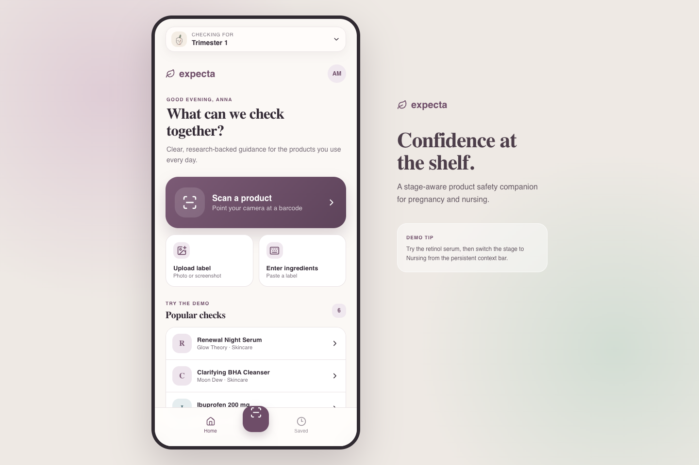
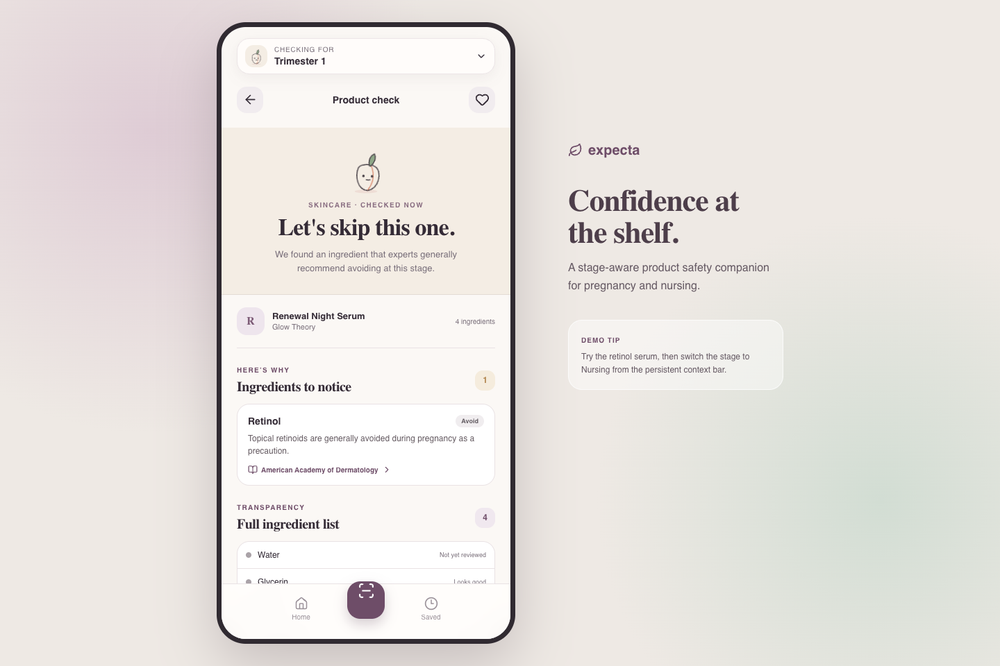

# Expecta

Expecta is a mobile-first product checker for people who are trying to conceive, pregnant, or nursing. Scan a barcode or paste an ingredient list and the app checks it against stage-specific guidance, explains what needs attention, and links back to the source.

I built this prototype for Cursor's July 2026 hackathon in Toronto.

> Expecta provides educational guidance, not medical advice. The current rule set is intentionally small and exists to demonstrate the product experience.

<p align="center">
  
  
</p>

## What the prototype does

- Switches guidance across five stages: planning, all three trimesters, and nursing
- Scans barcodes with the device camera or accepts a barcode manually
- Looks up live food data through [Open Food Facts](https://world.openfoodfacts.org/)
- Checks pasted ingredient lists against a local, sourced demo rule set
- Explains `safe`, `caution`, `avoid`, and `unknown` results
- Keeps recent checks and favorites in local storage

The label-photo button currently opens manual entry; OCR is part of the planned backend work, not this demo.

## Run it locally

Requires Node.js 24 or newer.

```bash
npm install
npm run dev
```

Then open the local URL printed by Vite. Try **Renewal Night Serum** from the home screen, then change the stage to see how the result responds.

## Tech

The app is built with React 19, TypeScript, Vite, ZXing, and Lucide icons. The prototype has no backend or account system. Evaluation rules and demo products live in the client, while history and favorites stay in the browser.

The proposed production architecture, API, data model, safety constraints, and rollout plan are documented in [design.md](design.md).

## Project commands

```bash
npm run dev          # start the development server
npm run build        # type-check and build
npm run lint         # run Oxlint
npm run screenshots  # refresh README screenshots using local Chrome
```
